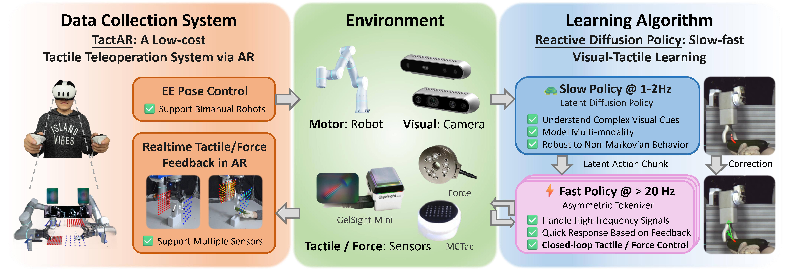

<h3 align="center">
    Reactive Diffusion Policy:
</h3>
<h4 align="center">
    Slow-Fast Visual-Tactile Policy Learning for Contact-Rich Manipulation
</h4>
<h4 align="center">
    RSS 2025
</h4>
<h4 align="center">
    Best Student Paper Award Finalist
</h4>
<p align="center">
    <a href="https://hanxue.me">Han Xue</a><sup>2*</sup>,
    Jieji Ren<sup>2*</sup>,
    <a href="https://wendichen.me">Wendi Chen</a><sup>12*</sup>,
    <br>
    <a href="https://www.gu-zhang.com">Gu Zhang</a><sup>345†</sup>,
    Yuan Fang<sup>2†</sup>,
    <a href="https://softrobotics.sjtu.edu.cn">Guoying Gu</a><sup>2</sup>,
    <a href="http://hxu.rocks">Huazhe Xu</a><sup>345‡</sup>,
    <a href="https://www.mvig.org">Cewu Lu</a><sup>12‡</sup>
    <br>
    <sup>1</sup>Shanghai Innovation Institute
    <sup>2</sup>Shanghai Jiao Tong University
    <br>
    <sup>3</sup>Tsinghua University, IIIS
    <sup>4</sup>Shanghai Qi Zhi Institute
    <sup>5</sup>Shanghai AI Lab
    <br>
    <sup>*</sup>Equal contribution
    <sup>†</sup>Equal contribution
    <sup>‡</sup>Equal advising
    <br>
</p>

<div align="center">
<a href='https://arxiv.org/abs/2503.02881'></a> &nbsp;&nbsp;&nbsp;&nbsp;
<a href='https://reactive-diffusion-policy.github.io'></a> &nbsp;&nbsp;&nbsp;&nbsp;
<a href='https://huggingface.co/datasets/WendiChen/reactive_diffusion_policy_dataset'></a> &nbsp;&nbsp;&nbsp;&nbsp;
<a href='https://huggingface.co/WendiChen/reactive_diffusion_policy_model'></a> &nbsp;&nbsp;&nbsp;&nbsp;
 &nbsp;&nbsp;&nbsp;&nbsp;
</div>

<p align="center">

</p>

## Overview

Reactive Diffusion Policy (RDP) is a visual-tactile policy for contact-rich robot manipulation. This repository contains the code for collecting and processing demonstrations, training Diffusion Policy (DP) and RDP (Asymmetric Tokenizer + Latent Diffusion Policy), and evaluating trained policies on robots. It includes the Flexiv setup used in the project and scripts for Franka and single-arm workflows.

The detailed instructions below assume you run commands from the repository root. Robot operation and data collection require the corresponding hardware and ROS 2 setup. For training, start with the [example dataset](https://huggingface.co/datasets/WendiChen/reactive_diffusion_policy_dataset) or process demonstrations into the Zarr format described below.

### Where to start

| Goal | Starting point |
| --- | --- |
| Set up a workstation or adapt a robot/task | [Environment Setup](#environment-setup) and the [customization guide](docs/customized_deployment_guide.md) |
| Collect and process demonstrations | [Data Collection](#data-collection), [record_data.py](scripts/data/record_data.py), and [post_process_data.py](scripts/data/post_process_data.py) |
| Train DP or RDP | [Training](#training) and the presets in [`scripts/train/`](scripts/train/) |
| Evaluate a checkpoint on a robot | [Inference](#inference) and [`scripts/eval/eval.sh`](scripts/eval/eval.sh) |

## News
- The [code](https://github.com/Chen-Wendi/ImplicitRDP) of [ImplicitRDP](https://implicit-rdp.github.io) has been open-sourced, feel free to [explore it and give it a try](https://github.com/Chen-Wendi/ImplicitRDP)! 🚀
- We propose [ImplicitRDP](https://implicit-rdp.github.io), an end-to-end version of RDP with a streamlined and simplified training pipeline — go [check it out](https://implicit-rdp.github.io)! 🚀

## Release status
- [x] Release the code of TactAR and [Quest3 APP](https://github.com/xiaoxiaoxh/TactAR_APP).
- [x] Release the code of RDP.
- [x] Release the [data](https://huggingface.co/datasets/WendiChen/reactive_diffusion_policy_dataset).
- [x] Release the [checkpoints](https://huggingface.co/WendiChen/reactive_diffusion_policy_model).
- [x] Add [guide for customized tasks, tactile / force sensors and robots](docs/customized_deployment_guide.md).
- [x] Add [guide for creating the tactile dataset and the tactile embedding](docs/tactile_embedding_guide.md).
- [x] Support more robots (e.g. Franka) and single-arm teleoperation.

## Repository layout

| Path | Purpose |
| --- | --- |
| `reactive_diffusion_policy/` | Importable policy, dataset, environment, and training code, with Hydra configurations under `config/`. |
| `scripts/train/` | Training entry point and training presets. |
| `scripts/eval/` | Policy evaluation entry point and rollout presets. |
| `scripts/teleop/`, `scripts/camera/`, `scripts/data/` | Robot, teleoperation, camera, and data collection entry points. |
| Other files under `scripts/` | Hardware launchers, dataset conversion, analysis, and visualization tools. |
| `tests/` | Automated checks. |
| `docs/` and `assets/` | Guides, diagrams, and example assets. |
| `third_party/` | SDK code and libraries used by optional hardware integrations. |

Generated datasets, checkpoints, ROS build products, and run logs are excluded from version control. Personal experiment notes and debug captures can be kept under `local/`. The dataset loader source under `reactive_diffusion_policy/dataset/` is part of the codebase.

## Environment Setup
### 📝 Use Customized Tactile / Force Sensors, Robots and Customized Tasks
Please refer to [docs/customized_deployment_guide.md](docs/customized_deployment_guide.md).

### Hardware
#### Device List
- Meta Quest 3 VR headset.
- Workstation with Ubuntu 22.04 for compatibility with ROS2 Humble.
    > A workstation with a GPU (e.g., NVIDIA RTX 3090) is required.
      If GelSight Mini is used, a high-performance CPU (e.g., Core i9-13900K) is required to
      ensure 24 FPS tactile sensing.
- 2 robot arms with (optional) joint torque sensors.
    > We use [Flexiv Rizon 4](https://www.flexiv.com/products/rizon) with the [GRAV](https://www.flexiv.com/products/grav) gripper by default.
    > We also support [Franka Research 3](https://franka.de/franka-research-3) with [Frankahand](https://download.franka.de/documents/220010_Product%20Manual_Franka%20Hand_1.2_EN.pdf) for teleoperation and policy rollout.
    > We now support single-arm robot.
- 1-3 [RealSense](https://www.intelrealsense.com) cameras.
    > We use D435 for wrist camera and D415 for external cameras.
      Follow the [official document](https://dev.intelrealsense.com/docs/compiling-librealsense-for-linux-ubuntu-guide) to install librealsense2.
      Download the [CAD model](https://drive.google.com/drive/folders/13tS5cMgPOnqIQvKm3XiM-n6DmyEc4qy2?usp=share_link) (redesigned, not the paper version) and 3D print the mount to attach the camera to the robot arm.
- (Optional) 1-2 [GelSight Mini](https://www.gelsight.com/gelsightmini) tactile sensors with [tracking marker gel](https://www.gelsight.com/product/tracking-marker-replacement-gel).
    > We use 1 sensor for each robot arm. Download the [CAD model](https://drive.google.com/drive/folders/13tS5cMgPOnqIQvKm3XiM-n6DmyEc4qy2?usp=share_link) and 3D print the mount to attach the sensor to the GRAV gripper.

### Software
#### Quest 3 Setup
Build and install the TactAR APP on the Quest 3 according to
the [README in our Unity Repo](https://github.com/xiaoxiaoxh/TactAR_APP).
> You can also adopt other Teleoperation system with force feedback.

#### Workstation Setup
1. Follow the [official document](https://docs.ros.org/en/humble/Installation/Ubuntu-Install-Debs.html)
to install ROS2 Humble.
2. Since ROS2 has some compatibility issues with Conda,
   we recommend using a virtual environment with `venv`.
   ```bash
   python3 -m venv rdp_venv
   source rdp_venv/bin/activate
   pip install torch==1.13.1+cu117 torchvision==0.14.1+cu117 torchaudio==0.13.1 --extra-index-url https://download.pytorch.org/whl/cu117
   pip install -r requirements.txt
   ```
3. (Optional) If you want to experiment on Franka, you can refer to [docs/franka_setup_instructions.md](docs/franka_setup_instructions.md) 
   for configuration.

4. (Optional) Follow [third_party/mvsdk/README.md](third_party/mvsdk/README.md)
   to install MindVision SDK. This package is needed only if you want to
   record experiment videos with MindVision cameras.

## Data Collection
### TactAR Setup
1. For the workstation,
the environment and the task have to be configured first and
then start several services for teleoperating robots, publishing sensor data and record the data.
    1. Environment and Task Configuration.
        - **Calibration.**
          Put calibration files in `data/calibration` and set `calibration_path` in the environment config. This local data directory is excluded from Git.
          Each `A_to_B_transform.json` contains the transformation from coordinate system A to coordinate system B. 
            > We use calibration files only for bimanual manipulation.
        - **Environment Configuration.**
          Edit [reactive_diffusion_policy/config/task/real_robot_env.yaml](reactive_diffusion_policy/config/task/real_robot_env.yaml)
          to configure the environment settings including `host_ip`, `robot_ip`, `vr_server_ip` and `calibration_path`.
        - **Task Configuration.**
          Create task config file which assigns the camera and sensor to use.
          You can take [reactive_diffusion_policy/config/task/real_peel_two_realsense_one_gelsight_one_mctac_24fps.yaml](reactive_diffusion_policy/config/task/real_peel_two_realsense_one_gelsight_one_mctac_24fps.yaml)
          as an example.
          Refer to [docs/customized_deployment_guide.md](docs/customized_deployment_guide.md) for more details.
   2. Start services. Run each command in a separate terminal.
      You can use tmux to split the terminal.
      ```bash
      # start teleoperation server
      python scripts/teleop/teleop.py task=[task_config_file_name]
      # start camera node launcher
      python scripts/camera/camera_node_launcher.py task=[task_config_file_name]
      # start data recorder
      python scripts/data/record_data.py --save_to_disk --save_file_dir [task_data_dir] --save_file_name [record_seq_file_name]
      ```
2. For Quest 3,
follow the [user guide in our Unity Repo](https://github.com/xiaoxiaoxh/TactAR_APP/blob/master/Docs/User_Guide.md)
to run the TactAR APP.

### (Important) Data Collection Tips
Please refer to [docs/data_collection_tips.md](docs/data_collection_tips.md).

### Example Data
We provide the data we collected on [](https://huggingface.co/datasets/WendiChen/reactive_diffusion_policy_dataset).

### Generate your own tactile embedding
Please refer to the [tactile embedding guide](docs/tactile_embedding_guide.md) for collecting your own tactile dataset and generate tactile embedding based on this dataset. Place PCA transformation matrices in `data/PCA_Transform_GelSight` before using them; local data files are excluded from Git.

### Data Postprocessing
Change the config in [post_process_data.py](scripts/data/post_process_data.py)
(including `TAG`, `ACTION_DIM`, `TEMPORAL_DOWNSAMPLE_RATIO` and `SENSOR_MODE`)
and execute the command
```bash
python scripts/data/post_process_data.py
```
We use [Zarr](https://zarr.dev/) to store the data.
After postprocessing, you may see the following structure:
```
 ├── action (25710, 4) float32
 ├── external_img (25710, 240, 320, 3) uint8
 ├── left_gripper1_img (25710, 240, 320, 3) uint8
 ├── left_gripper1_initial_marker (25710, 63, 2) float32
 ├── left_gripper1_marker_offset (25710, 63, 2) float32
 ├── left_gripper1_marker_offset_emb (25710, 15) float32
 ├── left_gripper2_img (25710, 240, 320, 3) uint8
 ├── left_gripper2_initial_marker (25710, 25, 2) float32
 ├── left_gripper2_marker_offset (25710, 25, 2) float32
 ├── left_gripper2_marker_offset_emb (25710, 15) float32
 ├── left_robot_gripper_force (25710, 1) float32
 ├── left_robot_gripper_width (25710, 1) float32
 ├── left_robot_tcp_pose (25710, 9) float32
 ├── left_robot_tcp_vel (25710, 6) float32
 ├── left_robot_tcp_wrench (25710, 6) float32
 ├── left_wrist_img (25710, 240, 320, 3) uint8
 ├── right_robot_gripper_force (25710, 1) float32
 ├── right_robot_gripper_width (25710, 1) float32
 ├── right_robot_tcp_pose (25710, 9) float32
 ├── right_robot_tcp_vel (25710, 6) float32
 ├── right_robot_tcp_wrench (25710, 6) float32
 ├── target (25710, 4) float32
 └── timestamp (25710,) float32
```
You can also use your own data collection system to collect data and convert it to the same `zarr` format as ours.

## Training
1. **Task Configuration.**
   In addition to the task config file used in [data collection](#data-collection),
   another file is needed to configure dataset, runner, and model-related parameters such as `obs` and `action`.
   You can take [reactive_diffusion_policy/config/task/real_peel_image_dp_absolute_12fps.yaml](reactive_diffusion_policy/config/task/real_peel_image_dp_absolute_12fps.yaml) as an example.
   Refer to [docs/customized_deployment_guide.md](docs/customized_deployment_guide.md) for more details.
   > The `dp`, `at` and `ldp` in the config file name indicate the Diffusion policy, Asymmetric Tokenizer and Latent Diffusion Policy.
2. **Generate Dataset with Correct Frequency.**
   The `fps` at the end of config file name indicates the control frequency.
   Make sure the `control_fps` in the task config file is consistent with dataset.
   For instance, we record 24fps data and want to train a model with 12fps control frequency,
   then we have to modify the `TEMPORAL_DOWNSAMPLE_RATIO` in [post_process_data.py](scripts/data/post_process_data.py)
   to 2 to generate the correct dataset.
   > We record 24fps data for experiments. 
     We train DP with 12fps control frequency and RDP (AT + LDP) with 24fps control frequency.
3. **Run the Training Script.**
   We provide training scripts for Diffusion Policy and Reactive Diffusion Policy.
   You can modify the training script to train the desired task and model.
   ```bash
   # config multi-gpu training
   accelerate config
   # Diffusion Policy
   ./scripts/train/train_dp.sh
   # Episode-first visual context, then tactile-only temporal conditioning
   ./scripts/train/train_dp_first_frame.sh
   # Reactive Diffusion Policy
   ./scripts/train/train_rdp.sh
   ```

## Inference
1. (Optional) Refer to `vcamera_server_ip` and `vcamera_server_port` in the task config file and start the corresponding vcamera server
   ```bash
   # run vcamera server
   python scripts/camera/vcamera_server.py --host_ip [host_ip] --port [port] --camera_id [camera_id]
   ```
2. Modify [eval.sh](scripts/eval/eval.sh) to set the task and model you want to evaluate
   and run the command in separate terminals.
   ```bash
   # start teleoperation server
   python scripts/teleop/teleop.py task=[task_config_file_name]
   # start camera node launcher
   python scripts/camera/camera_node_launcher.py task=[task_config_file_name]
   # start inference
   ./scripts/eval/eval.sh
   ```

### Checkpoints
We provide the checkpoints in our experiments
on [](https://huggingface.co/WendiChen/reactive_diffusion_policy_model).

## ❔ Q&A
Please refer to [docs/Q&A.md](docs/Q&A.md).

## 🙏 Acknowledgement
Our work is built upon
[Diffusion Policy](https://github.com/real-stanford/diffusion_policy),
[VQ-BeT](https://github.com/jayLEE0301/vq_bet_official),
[Stable Diffusion](https://github.com/CompVis/stable-diffusion),
[UMI](https://github.com/real-stanford/universal_manipulation_interface)
and [Data Scaling Laws](https://github.com/Fanqi-Lin/Data-Scaling-Laws).
Thanks for their great work!

## 🔗 Citation
If you find our work useful, please consider citing:
```
@inproceedings{xue2025reactive,
  title     = {Reactive Diffusion Policy: Slow-Fast Visual-Tactile Policy Learning for Contact-Rich Manipulation},
  author    = {Xue, Han and Ren, Jieji and Chen, Wendi and Zhang, Gu and Fang, Yuan and Gu, Guoying and Xu, Huazhe and Lu, Cewu},
  booktitle = {Proceedings of Robotics: Science and Systems (RSS)},
  year      = {2025}
}

@article{chen2025implicitrdp,
  title     = {ImplicitRDP: An End-to-End Visual-Force Diffusion Policy with Structural Slow-Fast Learning},
  author    = {Chen, Wendi and Xue, Han and Wang, Yi and Zhou, Fangyuan and Lv, Jun and Jin, Yang and Tang, Shirun and Wen, Chuan and Lu, Cewu},
  journal   = {arXiv preprint arXiv:2512.10946},
  year      = {2025}
}
```
